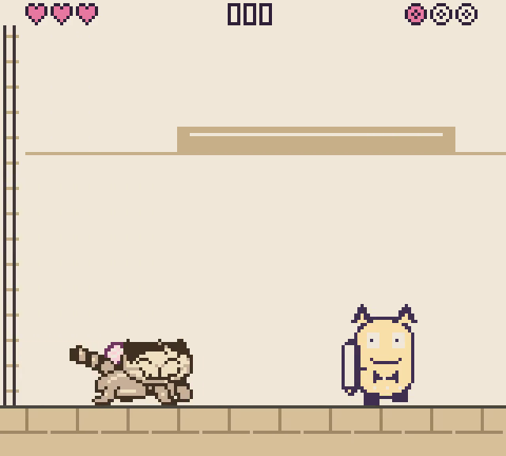
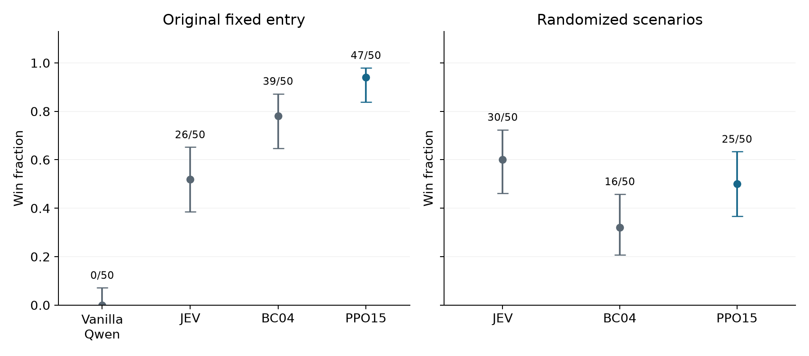

# Teaching a small language model to play

Reference implementation and analysis companion for Jintai Li's Head Goon study in
*Kittie Has Other Plans*. Pretrained Qwen3.5-0.8B learns from JEV demonstrations
through behavior cloning, then trains on its own episodes with PPO.

<a href="https://jintaili.github.io/kittie-game/training/">
  
</a>

The original encounter results are 0/50 for pretrained Qwen, 39/50 for BC04 and
47/50 for PPO15. The [article](https://jintaili.github.io/kittie-game/training/) and [supplement](https://jintaili.github.io/kittie-game/training/supplement.html)
retain the randomized results and the limits of one training lineage, retrospective
checkpoint selection and differing serving conditions.



## Read the implementation

The [methods and code guide](https://jintaili.github.io/kittie-game/training/methods.html) connects the calculations to the
experiment. `src/head_goon_study/` contains observation construction and button
mapping, action scoring, BC, PPO, advantages, critic fitting and rewards.
`configs/` records training settings. `provenance/source-map.json` traces each
extracted component to its historical source.

This companion includes reference components and recorded evaluation data. Model
weights, training trajectories, adapters, optimizer states and native emulator
integration are outside its scope.

## Analysis and checks

Python 3.12 or later. Numerical analysis uses only the standard library:

```sh
python paper/code/analysis.py
python -m unittest discover -s paper/code -p test_study.py
```

Synthetic CPU training and observation/reward checks:

```sh
python -m pip install -e '.[training-core]'
python -m unittest discover -s tests
```

Regenerate the figures and article:

```sh
python -m pip install -e '.[figures]'
python scripts/build_paper.py
python -m http.server 8000
```

Open `/paper/index.html`. The selected gameplay video is hosted by the game site.
The 560 included game records, latency observations and supplied scenario schedules
support the article's analysis without a model or API call. Historical export code
under `provenance/historical/` requires the original archive and is not needed here.

## Site export

The article source is `paper/code/paper.py`; the guide is `paper/code/guide.py`.
Generated pages and small browsing copies are exported into the game site's
`docs/training/`. The exporter also adds the third experiment card and navigation:

```sh
python scripts/build_paper.py
python scripts/export_site.py --site-root ../kittie-game/docs
```

On first export, supply `--video /path/to/selected/gameplay.mp4`. The exporter checks
its recorded hash and places it in the game site's assets. Later exports reuse the
verified site asset. No video or model binary is stored in this research repository.

## Licenses

Research code and configurations: [Apache-2.0](LICENSE).
Article, original statistical figures and released numerical data:
[CC BY 4.0](LICENSE-CONTENT), where the author holds rights.
Game artwork, photographs and third-party materials retain their existing terms.
See [NOTICE](NOTICE) and [THIRD_PARTY_NOTICES](THIRD_PARTY_NOTICES).
